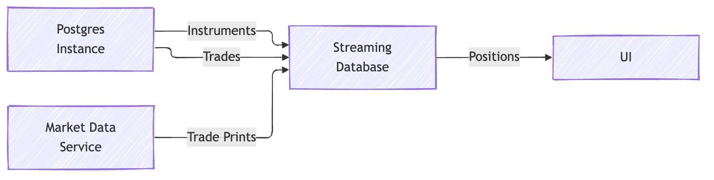
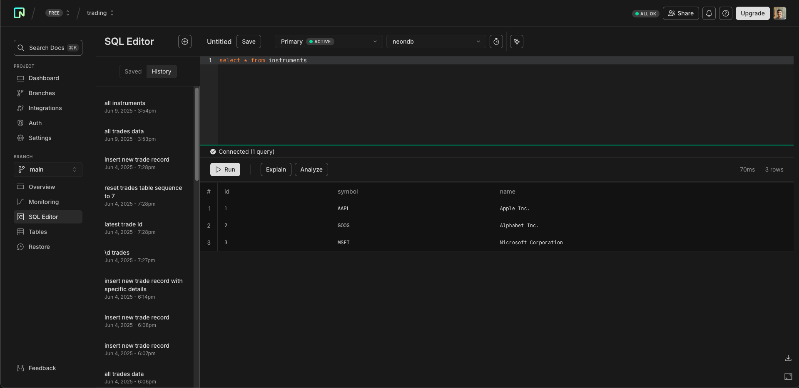
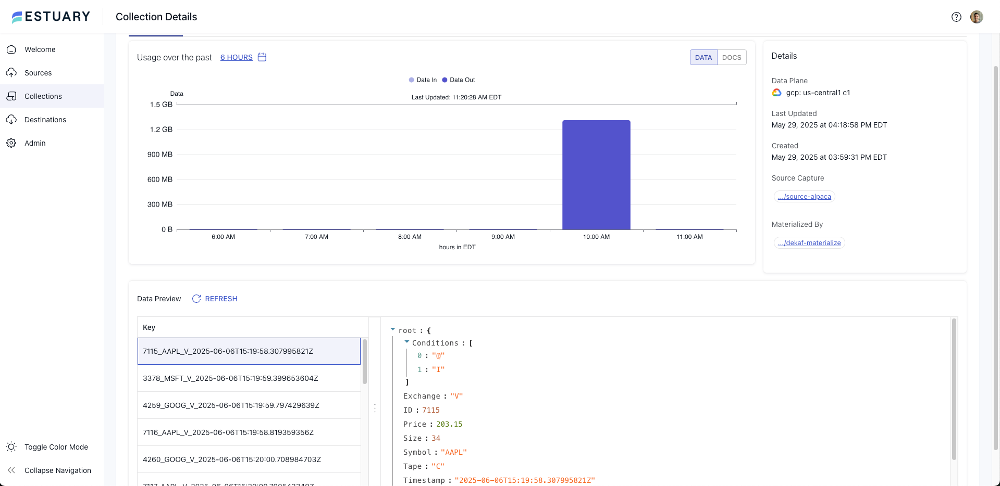
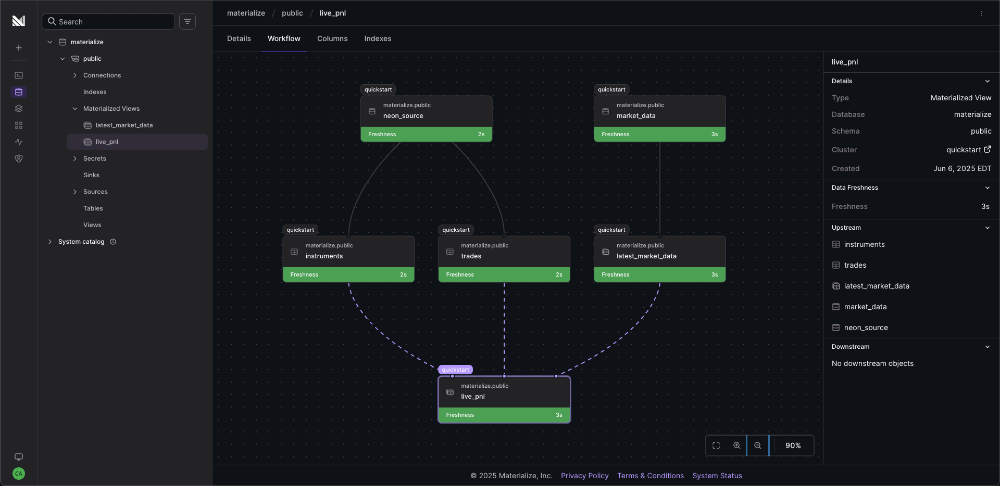
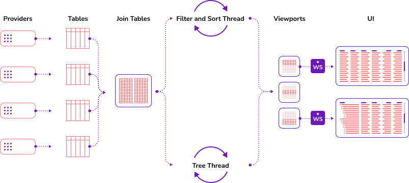
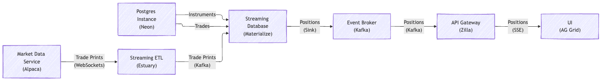

# Can a Streaming Database Power Trading Apps?

**Subtitle:** Building a Real-Time Positions UI with Materialize

---

*Updated November 2026: I reworked this experiment to use Kafka and Zilla instead of a custom Rust WebSocket relay, so the backend is composed entirely of off-the-shelf parts. I also swapped Perspective for AG Grid, to match later posts in this series.*

I used to work at [Genesis](https://genesis.global), a platform for rapidly building financial markets applications. The core idea behind the platform is simple: make it easier to build complex, real-time applications through familiar concepts like database tables and views. For example, to build a real-time view of stock positions, you could join a trades table with a market data table, calculate positions using an SQL-like `SUM()` function, and serve that to a UI with minimal code.

These ideas have been around for a while in capital markets, and are now becoming common in real-time data processing. Products like [Materialize](https://materialize.com) and [RisingWave](https://risingwave.com), for example, let developers build live views over streaming data with Postgres-compatible SQL, kept up to date with millisecond-level latency. These '[streaming databases](https://www.oreilly.com/library/view/streaming-databases/9781098154820/)' blur the line between databases and stream processors, and are gaining traction in areas like capital markets, manufacturing, and e-commerce.

This got me thinking recently about the trading desk of the future — what role might these technologies play, especially in the parts that don't need ultra-low latency? Will we see business logic pulled out of applications and centralized in tools like these? Could they power a real-time financial markets application?

To explore this, I set out to build a positions view powered by a streaming database, to see what's possible and where the friction lies.

## Designing the Application

For the UI, I wanted a simple grid showing live positions, market value, and theoretical P&L per instrument. It's a small scope, but it covers many of the things you'd expect in a financial markets application, such as live and static data, real-time calculations, and ticking frontend updates. On the backend, I wanted to approximate a production setup — secure, scalable, and fast — but built with open standards and as little custom code as possible.

The high-level architecture was therefore simple: trades and instruments flowing from a Postgres instance; market prices piped in from a cloud WebSocket feed; a materialized view for the positions logic; and results streamed out to a grid in the browser.

## Choosing the Streaming Database

One of the first big decisions was picking a streaming database to power the backend. I went with Materialize because it ticked all the boxes: broad SQL support, streaming over a standard Postgres connection, and strong consistency guarantees. But this space is evolving fast, and there were other solid contenders.

### Materialize

[Materialize](https://materialize.com) positions itself as a 'live data layer' for apps and agents. It supports Postgres-compatible SQL, is built in Rust, and uses [Timely and Differential Dataflow](https://github.com/TimelyDataflow) under the hood, enabling low latency and strong consistency across all views. You can query results on-demand or push updates out over Kafka or a Postgres connection, and it's easy to get started with their hosted offering and local development emulator.

### RisingWave

[RisingWave](https://risingwave.com) describes itself as a 'real-time event streaming platform' and appears similar to Materialize at first glance - SQL-first, Rust-based, and designed to make stream processing feel like working with Postgres. It's fully open source, built around open storage formats like Apache Iceberg, and has a high-performance '[Ultra](https://risingwave.com/risingwave-ultra/)' edition designed for use cases in financial markets and online betting. Unlike Materialize however, it doesn't guarantee strict consistency, meaning views can be temporarily out of sync.

### ksqlDB

[ksqlDB](https://ksqldb.io) is a streaming SQL engine for working with real-time data in Kafka. It supports SQL-like queries over Kafka topics, is source-available, and has built-in support for other Confluent products like Schema Registry. However, it uses its own SQL dialect rather than Postgres-compatible SQL, and [Confluent now recommends Flink](https://docs.confluent.io/platform/current/ksqldb/overview.html) for new stream processing work.

### Deephaven

[Deephaven](https://deephaven.io) is a Python-based real-time engine originally built at a hedge fund, tailored for financial data workflows. It comes with its own UI server and scripting environment, so you can build full-stack UIs with just a few lines of Python. It's powerful and polished, and would be a great choice if I were building this scope "for real." But it's a bit of an outlier — most streaming databases don't bundle a UI server — so it didn't feel like a good fit for this experiment.

## Building the Data Layer

With the streaming database chosen, I spun up a Materialize emulator instance — a single-container version of Materialize with the same developer experience as a production setup. Then, I could plug in trades and instruments from Postgres and market prices from a live feed, and build the positions logic on top.

### Trades and Instruments

For trades and instruments, I used [Neon](https://neon.com) — a managed Postgres service that's quick to set up and has a free tier. I used Claude to generate the tables and some fake data, and created a 'publication' so Materialize could subscribe to updates in real-time. I registered Neon as a source in Materialize, and the data was live.

### Market Data

To keep things realistic, I wanted to use real market data delivered over WebSockets. Claude suggested a few great options — like [Databento](https://databento.com) (great for latency-sensitive use cases) and [Polygon](https://polygon.io) (broad instrument coverage) — but I decided to go with [Alpaca](https://alpaca.markets) for its free tier and clean API.

That's when I realized I'd missed something: Materialize doesn't support WebSockets as a source. Oops. I could've switched streaming database (to e.g. Deephaven) or written a custom process to transform the data, but I wanted to avoid changing stack or adding glue code.

That's when I found [Estuary Flow](https://estuary.dev): a real-time ETL tool with native support for both Alpaca and Materialize. Within a few minutes, I'd configured Estuary's Alpaca connector for the IEX trades stream, mapped it to a Kafka topic, and registered it as a source in Materialize. Live prices were streaming in.

### Positions

The final step was to pull trades, instruments, and market prices together into a live positions view. I had Claude generate two materialized views: one to surface the latest trade price per instrument, and another to join everything together, aggregate trades into positions, and calculate market value and P&L.

I ran `SELECT * FROM live_pnl;` and, after a short 'hydration' period, watched my positions update in real time as trades and prices streamed in.

So far so good! I had a real-time view of positions, aggregated from trades and live prices, with just a few lines of SQL.

## Getting Data to the Browser

The next step was getting data from Materialize to a UI in real time, with minimal code. I began by looking into whether anyone had done this before, and what tools they'd used to make it work.

I found surprisingly little. There was a [Materialize plugin for Grafana](https://grafana.com/grafana/plugins/bsull-materialize-datasource/), which wasn't a good fit given Grafana's focus on monitoring. Some people were piping views to database tables to feed Streamlit or Metabase dashboards, which wasn't truly real-time. But most commonly, people were building their own lightweight processes to stream data over WebSockets, like [this blog post](https://dev.to/bobbyiliev/building-a-live-chart-with-deno-websockets-chartjs-and-materialize-3cd7) using Deno and Chart.js.

So I started looking more broadly. Were there other approaches that could work for my use case?

### REST and GraphQL

First I explored exposing Materialize over REST or GraphQL, both common APIs for front-end data access. REST was a non-starter — it isn't built for real-time — but GraphQL supports subscriptions and is well supported by most frontend frameworks.

That led me to [Hasura](https://hasura.io), a data access layer for Postgres. It exposes your database as a GraphQL API with minimal setup, featuring built-in filtering, joining, and access control. Since Materialize is Postgres-compatible it seemed like a perfect fit, but Hasura polls periodically rather than streaming changes in real time, which wouldn't give me the tick-by-tick updates I needed.

I also looked at [Apollo](https://www.apollographql.com), a more flexible way to build GraphQL APIs over any data source. It looked promising, but I'd still have needed to build an integration for Materialize. Since the main goal was to get streaming data into a UI with minimal effort, I didn't want to add another platform and a bunch of glue code.

### View Servers

Next I explored view servers, which are common in many financial markets applications. These components typically stream data from a data source to frontends over WebSockets, with built-in rate limiting and access control. Genesis and Deephaven, for example, both feature UI servers as part of their larger platforms (e.g. [Genesis' Data Server](https://docs.genesis.global/docs/develop/server-capabilities/real-time-queries-data-server/)), but these aren't available as standalone components.

[FinOS Vuu](https://vuu.finos.org/) was promising as an open source project designed for fast-moving data and many connected users. While it seemed straightforward to integrate and get running, I would've also needed to adopt its built-in grid, whereas I was more looking to compose a solution from standalone components.

### Streaming API Gateways

Finally I looked at streaming API gateways, which serve Kafka topics over standard web protocols. The idea was to stream the positions view out through a Kafka sink, so a gateway could cache the latest rows and push them to any number of connected UIs without adding load on Materialize.

I started with [Lightstreamer](https://lightstreamer.com), a push server widely used for real-time apps in finance, gaming, and aerospace. It's built for high-volume, low-latency data, with an open-source Kafka connector and throttling for slow clients. However, it uses its own protocol and client library, whereas I was looking to use open standards. I also looked at [Gravitee](https://www.gravitee.io), a full API management platform with its own console and database, but its Kafka support is only in the paid Enterprise edition.

Then I came across [Zilla](https://github.com/aklivity/zilla), a lightweight gateway that's quick to set up, with everything defined in a single YAML file. It was a great fit, since it supports open standards like server-sent events (SSE), gRPC, and MQTT, and has authentication, row-level entitlements, and filtering available in its community edition. I configured Zilla to read positions from a compacted Kafka topic and stream them over SSE, ready for the UI to pick up.

## Building the UI

Since the UI was simple — just a grid connected to an SSE stream — I went with plain HTML and JavaScript. I used [Vite](https://vite.dev) to build and serve it locally, so I could see changes instantly in the browser as I iterated.

For the grid, I needed something that could handle large, streaming datasets. I chose [AG Grid](https://www.ag-grid.com) as it had worked well for similar applications at Genesis, given its support for [row virtualization](https://www.ag-grid.com/javascript-data-grid/dom-virtualisation/) and [transaction updates](https://www.ag-grid.com/javascript-data-grid/data-update-transactions/).

To get data into the grid, I subscribed to Zilla's SSE stream using the standard `EventSource` API. As events arrived, the UI determined whether each was an insert, update, or delete, and applied it to AG Grid as a transaction. You can find the code on GitHub: [tycoworks/positions-app](https://github.com/tycoworks/positions-app/tree/v1).

## Conclusion

So, can a streaming database power a real-time financial markets application? I believe so. I built a real-time positions UI with Materialize at its core, with about 30 lines of SQL and 120 of JavaScript. And since it used proven, off-the-shelf parts, there was a clear path to production, even if I hadn't optimized for latency, scale, or security.

While getting data into Materialize was straightforward, getting data out was fiddlier than expected. Zilla itself was easy to get up and running, [designed for performance](https://www.aklivity.io/post/how-zilla-works), and had entitlements, filtering, and scalability built in. However, going through Kafka meant defining every view up front in Materialize, whereas many applications need arbitrary queries and joins on the fly.

Is there a product here? Something based on GraphQL, like Hasura but for streaming databases? Is there demand for streaming data into UIs, or is the bigger opportunity in powering AI agents? That's what I'll [look at next](https://www.tycoworks.com/p/tycostream-turn-materialize-views).
