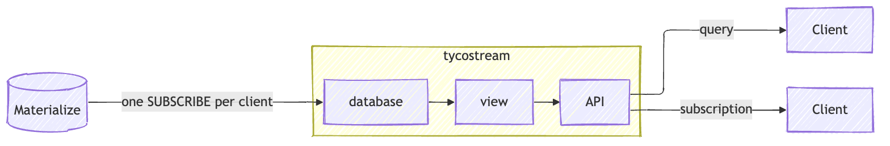
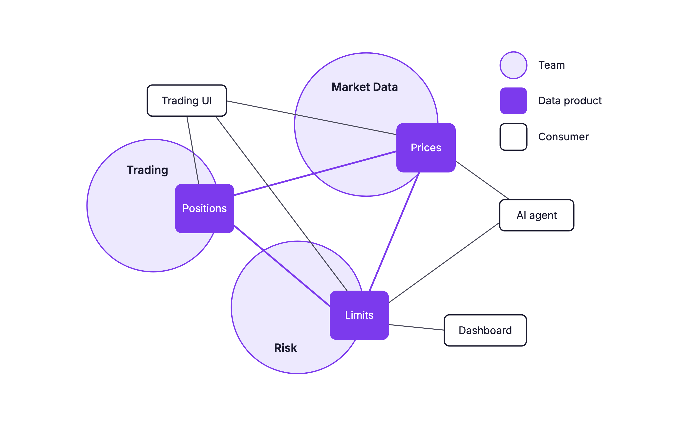

# Can You Build a View Server with Materialize and GraphQL?

**Subtitle:** Building an API layer for streaming databases

---

*Updated November 2026: I reworked tycostream to use a Materialize subscription per client rather than a shared cache, and removed the triggers feature entirely. I also swapped WebSockets for server-sent events to match [the last post](https://tycoworks.substack.com/p/can-a-streaming-database-power-a).*

In my [last post](https://tycoworks.substack.com/p/can-a-streaming-database-power-a), I explored whether streaming databases like [Materialize](https://materialize.com/) could power a trading desk UI. The answer was a cautious yes: creating the backend logic was straightforward, but getting data into the frontend was trickier. I used [Zilla](https://github.com/aklivity/zilla) to stream data from a Materialize Kafka sink, as it was quick to set up, had built-in permissions, and supported WebSockets and server-sent events. However, going through Kafka would make releases more difficult, requiring coordinated frontend and backend changes as well as topic backfills.

Many financial markets applications instead use dedicated 'view servers' to deliver data. These components, such as [FinOS Vuu](https://vuu.finos.org/) and the [Genesis Data Server](https://docs.genesis.global/docs/develop/server-capabilities/real-time-queries-data-server/), allow connected frontends to query and subscribe to live data on demand, with support for joins, throttling, and permissions. Materialize already handled querying and joining live data. Could I build the delivery side, to create a complete view server?

To find out, I've started working on [tycostream](https://github.com/tycoworks/tycostream), which turns Materialize views into real-time GraphQL APIs. Let's take a look.

## How It Works

tycostream works a bit like [Hasura](https://hasura.io/), but for streaming databases. It connects to Materialize and exposes a GraphQL query and subscription for each configured view:

- **Query**: a one-off fetch of a view's current rows.

- **Subscription**: a live stream of a view's rows and subsequent changes.

Under the hood, it generates the API, connects to Materialize, and delivers live updates.



tycostream [architecture](https://github.com/tycoworks/tycostream/blob/main/docs/architecture.md)

### 1. Generating The API

A `schema.yaml` file tells tycostream which views to expose and how they relate to each other. For example, here's how you'd describe the `positions` and `trades` views from my last post, with their primary and foreign keys:

```yaml
sources:
  positions:
    primary_key: instrument_id
    columns:
      instrument_id: int4
      symbol: text
      net_position: int8
      latest_price: numeric
      market_value: numeric
      avg_cost_basis: numeric
      theoretical_pnl: numeric
  trades:
    primary_key: id
    columns:
      id: int4
      instrument_id: int4
      quantity: int4
      price: numeric
      executed_at: timestamp
    foreign_keys:
      instrument_id: positions
```

tycostream reads that file and generates types, queries, and subscriptions for each view:

```graphql
type query_root {
  positions(where: positions_bool_exp, order_by: [positions_order_by!], limit: Int, offset: Int): [positions!]!
  trades(where: trades_bool_exp, order_by: [trades_order_by!], limit: Int, offset: Int): [trades!]!
}

type subscription_root {
  positions(where: positions_bool_exp, order_by: [positions_order_by!], limit: Int, offset: Int): [positions_update!]!
  trades(where: trades_bool_exp, order_by: [trades_order_by!], limit: Int, offset: Int): [trades_update!]!
}

type positions {
  instrument_id: Int!
  symbol: String
  net_position: bigint
  latest_price: numeric
  market_value: numeric
  avg_cost_basis: numeric
  theoretical_pnl: numeric
  trades(where: trades_bool_exp, order_by: [trades_order_by!], limit: Int, offset: Int): [trades!]!
}

type positions_update {
  operation: row_operation!
  data: positions
  fields: [String!]!
  trades(where: trades_bool_exp, order_by: [trades_order_by!], limit: Int, offset: Int): [trades_update!]!
}

type trades {
  id: Int!
  instrument_id: Int
  quantity: Int
  price: numeric
  executed_at: timestamp
  positions: positions
}

type trades_update {
  operation: row_operation!
  data: trades
  fields: [String!]!
}

enum row_operation {
  INSERT
  UPDATE
  DELETE
}

...
```

Clients can then query or subscribe to each view, using Hasura-style [filtering](https://github.com/tycoworks/tycostream/blob/main/docs/api.md#filters), [sorting, and paging](https://github.com/tycoworks/tycostream/blob/main/docs/api.md#sorting-and-paging). And because it's GraphQL, a client can also join related views in a single query. For example, here's how you'd subscribe to the `AAPL` position and its two latest trades:

```graphql
subscription {
  positions(where: {symbol: {_eq: "AAPL"}}) {
    operation
    fields
    data { instrument_id symbol net_position latest_price market_value }
    trades(order_by: [{executed_at: desc}], limit: 2) {
      operation
      fields
      data { id quantity price }
    }
  }
}
```

### 2. Connecting To Materialize

tycostream maintains a Postgres connection pool to Materialize, with each request getting its own connection. View servers would normally cache data, so they can fan out similar requests to many clients without additional load on the data store. But I wanted to keep things simple for now, and let Materialize do the filtering and joining.

Each client request is then compiled into an SQL statement. This is mostly straightforward, with filters becoming `where` clauses, sorting becoming `order by` clauses, and so on. Joins are trickier, however, since SQL is designed for flat rows, whereas GraphQL works with trees.

To handle this, the generated SQL returns one flat table, where each row contains its level in the tree, its parent, and its data as JSON. For example, the `AAPL` subscription above generates the following statement, where `$1` is `AAPL` and `$2` is `2`:

```sql
with "__source_0" as (
  select "__rows".* from (
    select "instrument_id" as "instrument_id", "symbol" as "symbol", "net_position" as "net_position",
           "latest_price" as "latest_price", "market_value" as "market_value"
    from "positions" as "positions"
    where "symbol" = $1
  ) as "__rows"
),
"__source_1" as (
  select "__source_0"."instrument_id" as "__key_0", "__rows".*
  from "__source_0" as "__source_0"
  cross join lateral (
    select "id" as "id", "quantity" as "quantity", "price" as "price"
    from "trades" as "trades"
    where "trades"."instrument_id" = "__source_0"."instrument_id"
    order by "executed_at" desc
    limit $2
  ) as "__rows"
)
select 0 as "__source",
       jsonb_build_array(cast("__source_0"."instrument_id" as text)) as "__keys",
       jsonb_build_object(
         'instrument_id', cast("__source_0"."instrument_id" as text),
         'symbol', cast("__source_0"."symbol" as text),
         'net_position', cast("__source_0"."net_position" as text),
         'latest_price', cast("__source_0"."latest_price" as text),
         'market_value', cast("__source_0"."market_value" as text)
       ) as "__row"
from "__source_0" as "__source_0"
union all
select 1 as "__source",
       jsonb_build_array(cast("__source_1"."__key_0" as text), cast("__source_1"."id" as text)) as "__keys",
       jsonb_build_object(
         'id', cast("__source_1"."id" as text),
         'quantity', cast("__source_1"."quantity" as text),
         'price', cast("__source_1"."price" as text)
       ) as "__row"
from "__source_1" as "__source_1"
```

tycostream then runs the SQL as is for queries, or as a [`SUBSCRIBE`](https://materialize.com/docs/sql/subscribe/) statement for subscriptions. `SUBSCRIBE` is a rare feature among streaming databases, allowing clients to stream changes over a standard Postgres connection. It accepts arbitrary SQL, so you can filter, join, and aggregate views and tables on the fly, and its `PROGRESS` option signals when each batch of updates for a timestamp is complete.

### 3. Delivering Updates

tycostream streams updates to clients in the shape originally requested. For example, for the `AAPL` subscription above, a client would first receive a snapshot:

```json
{
  "data": {
    "positions": [
      {
        "operation": "INSERT",
        "fields": ["instrument_id", "symbol", "net_position", "latest_price", "market_value"],
        "data": {"instrument_id": 1, "symbol": "AAPL", "net_position": 660, "latest_price": 201.01, "market_value": 132666.6},
        "trades": [
          {"operation": "INSERT", "fields": ["id", "quantity", "price"], "data": {"id": 16, "quantity": 10, "price": 200.9}},
          {"operation": "INSERT", "fields": ["id", "quantity", "price"], "data": {"id": 15, "quantity": -40, "price": 200.32}}
        ]
      }
    ]
  }
}
```

After that, it would receive updates for the rows that changed, such as this price tick:

```json
{
  "data": {
    "positions": [
      {
        "operation": "UPDATE",
        "fields": ["instrument_id", "latest_price", "market_value"],
        "data": {"instrument_id": 1, "symbol": null, "net_position": null, "latest_price": 201.31, "market_value": 132864.6},
        "trades": []
      }
    ]
  }
}
```

All related updates arrive together in the same message. For example, a new trade would result in a position update, and so tycostream would send both updates together. This is powered by Materialize's strong consistency guarantees, where related updates share the same timestamp.

Finally, tycostream streams each message over server-sent events, and applies back pressure so that a slow client's backlog builds up in Materialize rather than in tycostream.

## Try It Out

Want to see tycostream in action? There's a [positions dashboard demo](https://github.com/tycoworks/positions-app/tree/v2) you can spin up locally, with Docker Compose for the backend and npm for the frontend. It uses a lightweight simulator to generate trades and market data, a Materialize emulator instance to calculate real-time positions as materialized views, and tycostream subscriptions to stream everything to the frontend.


To run tycostream against your own Materialize instance, there's a quick start in the [README](https://github.com/tycoworks/tycostream#getting-started), as well as a [guide](https://github.com/tycoworks/tycostream/blob/main/docs/guide.md) for a more detailed walkthrough. There's also an [agent skill](https://github.com/tycoworks/tycostream/tree/main/skills/create-schema) that reads your views and writes the `schema.yaml` file for you.

## Future Gazing

Where could it go from here? The obvious next steps are authentication, permissions, fan-out, and throttling, which are table stakes for any production view server or API gateway. Perhaps the better question is whether it's worth building out further. I haven't tested the demand, so I don't know, but I can tell you where I think streaming databases and GraphQL are heading.

In my last post, I asked whether we'd see business logic pulled out of applications and centralized in streaming databases. Turns out there's already a name for this pattern: the [streaming data mesh](https://www.oreilly.com/library/view/streaming-data-mesh/9781098130718/). The idea is that individual teams can publish well-defined, versioned "data products" that anyone can use, thereby creating internal APIs for live data.



I believe streaming databases like Materialize are the unlock for this pattern. They let developers join and transform live data using standard SQL, making it much easier to build scalable, real-time applications. And as demand for streaming databases grows, I expect we'll need an ecosystem of tools around them, such as API layers for access and permissions for security. This is where tycostream could fit in.

Imagine being able to vibe code a positions dashboard in something like [Retool](https://retool.com/). Under the hood, it's a simple case of connecting workflows and UI elements to live data products via GraphQL, making streaming applications as easy to build as CRUD.

## Conclusion

So, can you build a view server with Materialize and GraphQL? I believe so, or at least the essence of one. Materialize handles the querying, joining, and consistency, while GraphQL adds a typed API that frontends can query and subscribe to on demand. And because GraphQL and the Postgres wire protocol are open standards with mature libraries, tycostream took less than 4,000 lines of TypeScript to build.

GraphQL has its downsides, though. Its messages are verbose JSON, so I doubt it would suit ultra-low latency use cases. Every update also has to carry the full set of fields, so I had to invent a [convention for incremental updates](https://github.com/tycoworks/tycostream/blob/main/docs/api.md#updates), making each message bigger than it should be. Finally, it doesn't support changing an open subscription, which would make [viewporting](https://vuu.finos.org/docs/providers_tables_viewports/viewports/) difficult.

If you're building real-time applications with SQL and GraphQL, I'd love to hear from you. What problems are you solving? What would make this useful for your use case? Drop me a line here or at <chris@tycoworks.com>.
