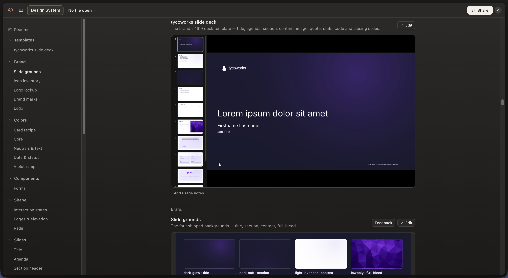
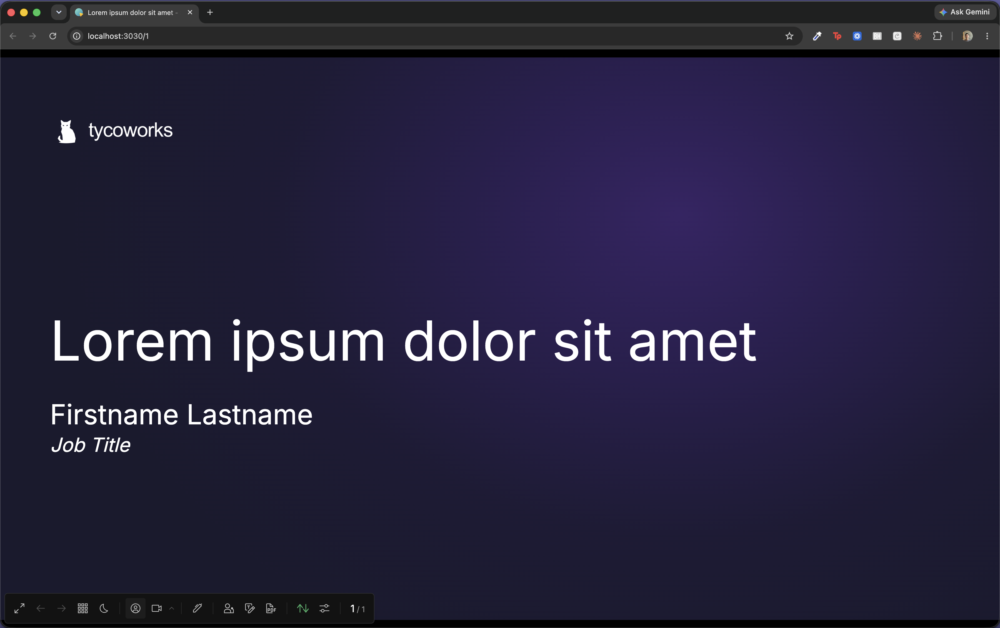
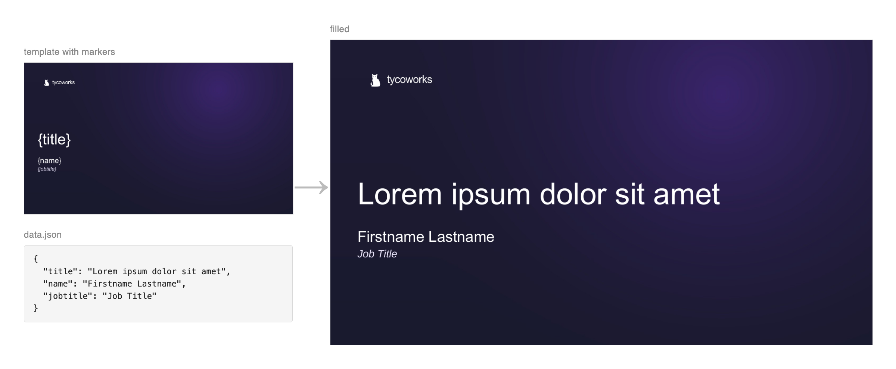
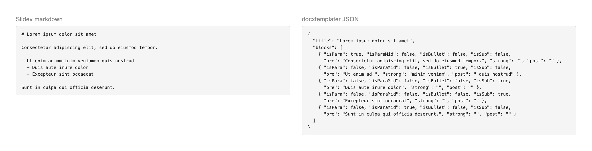

# Can Slides Be Built From Source Files?

**Subtitle:** Creating editable PowerPoint files from markdown, using existing .pptx templates

---

*This post is the story of how I built tycoslide, which turns markdown into editable PowerPoint slides using your existing template. To skip straight to trying it, see [tycoslide on GitHub](https://github.com/tycoworks/tycoslide).*

I do product strategy and product marketing for early-stage startups, mostly with technical products like databases and developer tools. A lot of the work is helping dial in their roadmap, messaging, and positioning. But I also help create finished collateral from those foundations, such as one-pagers, pitch decks, and battlecards.

One of the biggest challenges is keeping everything in sync. Make a change to the messaging, for example, and I may need to change every one-pager, every pitch deck, and every battlecard. AI agents like Claude Code can quickly make such changes to plain text, such as markdown files or wiki pages. But editing PowerPoint files or Canva designs takes longer, and there's no easy way to verify the result without opening and checking each file.

This got me thinking about static site generators such as [Hugo](https://gohugo.io), which build finished web pages from plain text content. Could presentations and collateral work in a similar way? Could I instead build these assets from declarative source files? I decided to find out.

## Exploring the Options

We've seen a wave of new AI slide tools over the past few years, which have changed the way slides and collateral are made. [Gamma](https://gamma.app), for example, lets you build a deck through prompts rather than clicking around in a UI. [NotebookLM](https://notebook.google.com/) goes further, using image generation models to produce high-fidelity slides and infographics. And [Claude Design](https://claude.com/product/design) can build a complete design system, helping you create slides, one-pagers, and mockups with a common look and feel.

However, none of these tools suited my use case, as they work from prompts that can be interpreted differently each time, rather than from source files like Hugo does. I needed a tool that could:

1. Generate slides from source files that I could track in Git.
2. Produce editable output that clients could open in their existing tools.
3. Match a client's existing design system exactly.

That narrowed the search to markdown presentation tools and template engines.

### Markdown Presentation Tools

[Marp](https://marp.app) and [Slidev](https://sli.dev) are examples of markdown presentation tools, which work in a similar way to Hugo. You write slides as markdown files, which are then rendered into HTML and exported to PDF or PowerPoint. You can customize the design system of each with CSS, and both have open-source themes to start from, such as [Neversink](https://github.com/gureckis/slidev-theme-neversink) for Slidev. Both are popular with engineers and engineering use cases, with support for code syntax highlighting and [Mermaid](https://mermaid.js.org) diagrams.

Slidev in particular looked promising, given its extensible component model based on [Vue](https://vuejs.org). I implemented my `tycoworks` color scheme and slide layouts in CSS, and built some Vue components for things I commonly use, such as timeline views and comparison matrices.

The result looked great, but there was a big problem: neither Slidev nor Marp export editable PowerPoint files. Both render each slide to an image using a headless browser, rather than implementing the design as native PowerPoint objects, and so I had to keep searching.

### Template Engines

Template engines work by filling in placeholders within PowerPoint files, such as `{title}` typed into the title slide. It's a tried and tested approach so there are plenty of options, from open-source libraries like [docxtemplater](https://docxtemplater.com) through to commercial products like [Conga Composer](https://conga.com/products/conga-composer). The big advantage is that you reuse your existing slides, so these tools are quick to set up and the output is editable and on brand by design.

I tried docxtemplater, since it's open core, has been around for over a decade, and supports Word and Excel as well as PowerPoint. I first added placeholders to my slides, such as `{title}`, `{name}`, and `{jobtitle}` in the case of the opening slide. I could then write new presentations as JSON files of key-value pairs, which docxtemplater merges into the slides.

It was simple and my slides looked perfect, but this simplicity was also a limitation. While template engines work well for plain text values like `{title}`, swapping in whole *blocks* of text, with any mix of bullets, paragraphs, and formatting, is harder. With docxtemplater, you have to slice content into separate text runs to apply different formatting, which can make the JSON unwieldy and hard to diff versus markdown.

## Filling in the Gap

Both approaches had their strengths. Slidev let me write slides in markdown, whereas docxtemplater gave me native slides I could edit. But I needed a tool that could do both and more, so I set out to build one.

My [first attempt](https://github.com/tycoworks/tycoslide/tree/166aeb6) was similar to Slidev, but with its own flexbox-based DSL instead of raw CSS and Vue. You defined design tokens, layouts, and components with TypeScript, then wrote the slides themselves in markdown. Under the hood, it rendered each slide as HTML, measured the position and size of every object, then wrote an editable PowerPoint file with [pptxgenjs](https://gitbrent.github.io/PptxGenJS/).

However, I eventually abandoned this idea due to differences between HTML and PowerPoint rendering. Slight variations in glyph widths, line heights, and text wrapping meant a line could break differently in PowerPoint, throwing off the position of everything around it. I'd also need to support a huge amount of HTML *and* PowerPoint for it to be useful, further confirming it was the wrong approach.

So I kept the markdown layer but replaced the renderer underneath with a template engine. The result was [tycoslide](https://github.com/tycoworks/tycoslide).

## How It Works

tycoslide is a template engine with a markdown front end. You start by wrapping your existing `.pptx` file as a 'theme' — an npm package that describes layouts, colors, and fonts — which you can version and manage like code. You then write slides in [GitHub-flavored markdown](https://github.github.com/gfm/), including code blocks and Mermaid diagrams, which tycoslide turns into editable PowerPoint files.

[video: video.mov — Building a deck with tycoslide and the tycoworks theme]

Rather than putting placeholders like `{title}` directly into the template, tycoslide uses a separate manifest to describe the available text, tables, and images per layout. Under the hood, it uses [pptx-automizer](https://github.com/singerla/pptx-automizer) to fill the template, [remark](https://github.com/remarkjs/remark) to parse the markdown, and [Shiki](https://shiki.style) to highlight code. It also packages each theme as an agent skill.

Want to try it out? The [guide](https://github.com/tycoworks/tycoslide/blob/main/docs/guide.md) walks you through setting tycoslide up on your template, including packaging it as a skill for your team. Or if you just want to see it in action, the [tycoworks theme](https://github.com/tycoworks/tycoworks-theme) and its two example decks are a good place to start.

## Conclusion

So, can slides be built from source files? For me, yes. Most of my decks are now themes and markdown files in Git, which Claude Code can update in bulk when things change. And because the theme enforces the design, I don't need to visually check each change, so I can work entirely through pull requests like code.

Where could it go from here? There are some near-term features I need, like supporting charts and multiple PowerPoint files per theme, so I can build one-pagers, pitch decks, and battlecards from the same theme. I could also add a template system, so that common content like taglines could be injected instead of duplicated (a template engine inside a template engine? *Meta*).

But my bet is to keep tycoslide simple and build more into the agent layer instead. [Skills](https://agentskills.io) have become a common standard for giving agents new capabilities, replacing a lot of custom code. Frontier LLMs are becoming cheaper and more capable every week. And new decision models like [Jev](https://typesafe.ai/blog/introducing-system-one-models-and-jev) and [Laya](https://github.com/NandhaKishorM/laya) could detect outdated messaging or banned terms in milliseconds, making them fast and cheap enough to run on every change.

If you've also been thinking about this, I'd love to hear from you. What have you tried? Did tycoslide work for you? Drop me a line here or at chris@tycoworks.com.
